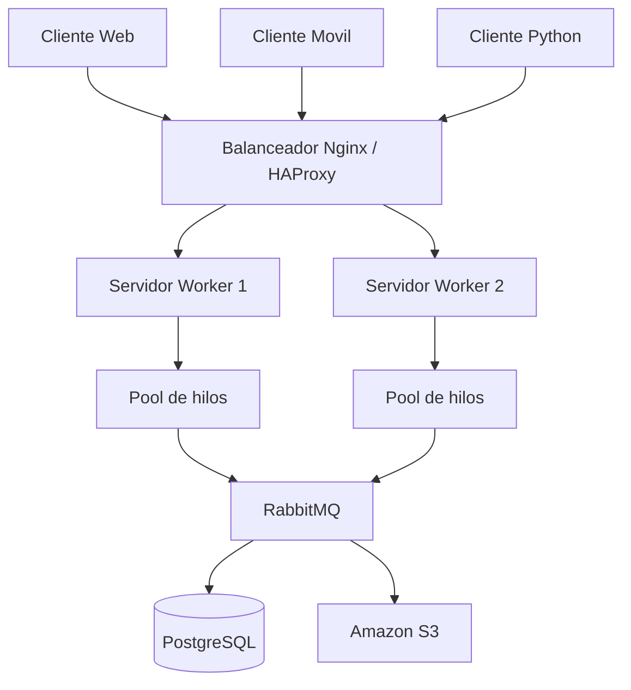

# Diagrama de Arquitectura - PFO 3

## Sistema Distribuido Cliente-Servidor

El siguiente diagrama representa la arquitectura propuesta para el sistema distribuido.

## Componentes

- **Clientes:** envían solicitudes al sistema.
- **Balanceador de carga:** distribuye las solicitudes entre servidores.
- **Servidores workers:** reciben y procesan tareas.
- **Pool de hilos:** permite procesar múltiples tareas concurrentemente.
- **RabbitMQ:** gestiona la comunicación mediante colas de mensajes.
- **PostgreSQL:** almacena datos y resultados.
- **Amazon S3:** almacena archivos.

## Flujo de funcionamiento

1. El cliente envía una solicitud.
2. El balanceador selecciona un servidor.
3. El servidor recibe la tarea mediante un socket TCP.
4. Un worker procesa la solicitud.
5. RabbitMQ permite la comunicación entre servidores.
6. Los resultados pueden almacenarse en PostgreSQL.
7. Los archivos pueden almacenarse en Amazon S3.
8. El servidor devuelve el resultado al cliente.
